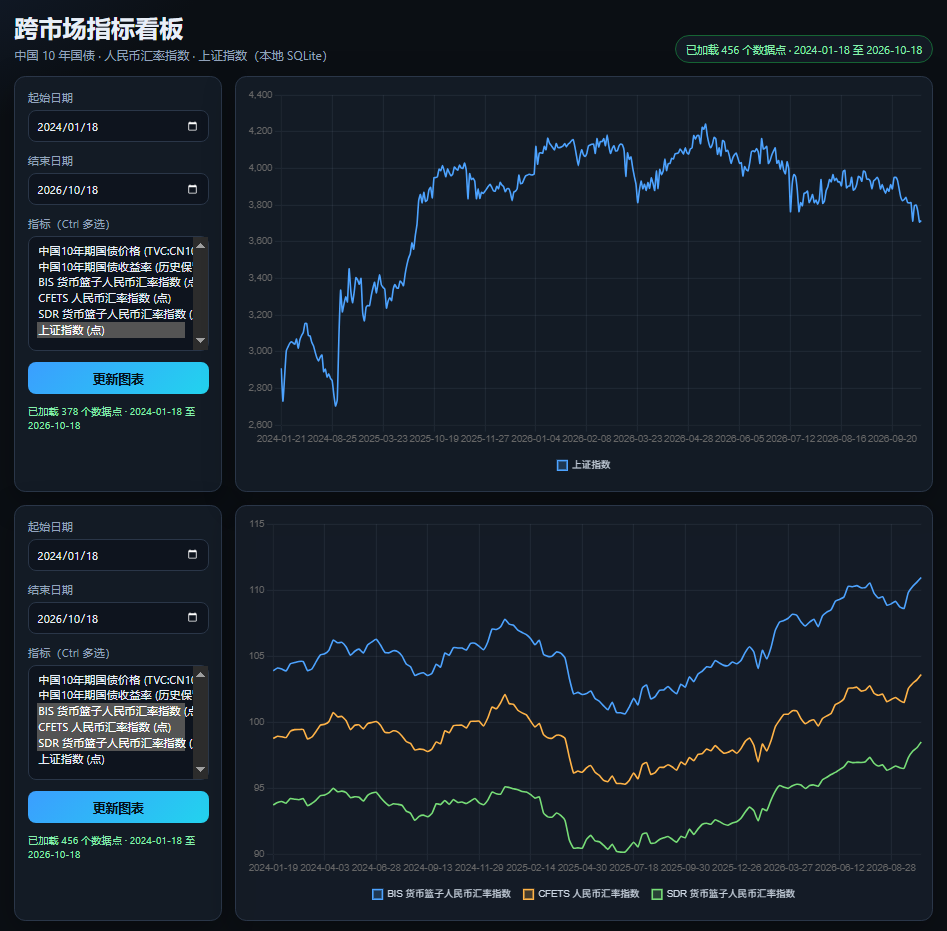

# IntermarketAnalysis

## 关于

**A 股跨市场本地看板**：自动抓取股、债、汇、商品等公开数据，存进本机 SQLite，用浏览器看双图对比和简单分析摘要。

- **适合谁**：想自己盯 A 股与周边市场、又不想依赖付费终端或在线图表的人  
- **你能得到**：增量更新的历史序列、归一化折线、快捷预设（宽基 / 期现 / 四腿等）、股债汇与指数 SMT 文字摘要  
- **技术栈**：Python + [Scrapling](https://github.com/D4Vinci/Scrapling) 抓取，内置静态页 + Chart.js，无重型 Web 框架

<p align="center">
  <a href="https://github.com/Torres999/IntermarketAnalysis">
    
  </a>
</p>
<p align="center"><sub>上下两块面板默认同屏对比；快捷预设会同步指标，也可分别多选做差异分析。</sub></p>

<p align="center">
  <strong>最快上手</strong>：安装后双击 <code>start.bat</code>（或运行 <code>.\start.ps1</code>），浏览器打开
  <a href="http://127.0.0.1:8765/">http://127.0.0.1:8765/</a>
</p>

## 为何选择 Scrapling 而不是 Crawl4AI

| 维度 | Scrapling | Crawl4AI |
| --- | --- | --- |
| 目标场景 | 结构化抓取、XPath/CSS、并发 Spider、反爬浏览器 | 页面转 Markdown/JSON，服务 LLM/RAG |
| 金融时间序列 | `record_requests` 捕获 XHR/API，适合 TradingView / Investing | 需从 Markdown 再解析，稳定性较差 |
| 反爬 | `StealthyFetcher` / Cloudflare 绕过 | 有 Playwright，但更偏内容抽取 |
| 依赖体积 | 以 curl_cffi + Patchright 为主 | 浏览器栈 + 可选 LLM 相关能力 |

本项目需要**稳定数值序列 + 增量更新 + 本地 SQLite**，Scrapling 更贴合；Crawl4AI 更适合“整页给大模型读”。

Scrapling 源码已 vendored 在 `vendor/scrapling/`，通过 `requirements.txt` 以 editable 方式安装。

## 数据源

| 类别 | series_id | 说明 |
| --- | --- | --- |
| 债券 | `cn10y` / `cn10y_yield` | 10Y 国债价格 / 收益率（分析摘要以 yield 为主；图表四腿预设用价格） |
| 汇率 | `rmb_cfets` / `rmb_bis` / `rmb_sdr` | 中国货币网人民币汇率指数 |
| 现货指数 | `sse_composite`, `sse50`, `csi300`, … | 东方财富日 K（替代 Investing sbcharts 误曲线） |
| 股指期货 | `future_ih` / `future_if` / `future_ic` / `future_im` | 新浪主连 IH0/IF0/IC0/IM0，约 5 年日 K |
| 大宗 | `comm_au`, `comm_cu`, `comm_sc`, `comm_rb`, `nh_commodity` | 新浪主连 + 本地等权综合指数 |

选型与稳定性说明见 [docs/DATA_SOURCES.md](docs/DATA_SOURCES.md)。

部分站点需在图表页选择 **「5 年」** 后再解析接口（见 `intermarket_analysis/scrapers/`）。

## 环境要求

- Python 3.10+
- Windows 上推荐 PowerShell；`setup.ps1` / `start.ps1` 为 PowerShell 脚本
- 图表使用项目内 vendored 的 Chart.js（`web/static/chart.umd.min.js`）

## 安装

1. 克隆本仓库并进入项目目录  
2. 在项目根目录执行：

```powershell
.\setup.ps1
```

脚本会创建虚拟环境、安装依赖，并把 Patchright 浏览器下载到项目下的 `.browsers/`。  
若浏览器下载失败，可设置 `$env:INTERMARKET_REAL_CHROME = "1"` 改用本机 Chrome 再运行 `python main.py scrape`。

## 使用

**日常**：在项目根目录运行 `.\start.ps1` 或双击 `start.bat`（增量抓取 + 启动看板）。

其他常用命令（均在项目根目录、已激活 venv 或直接用 `python`）：

```powershell
python main.py scrape          # 仅增量抓取
python main.py backfill-charts # 清空并重抓图表类序列
python main.py analyze         # 刷新多资产分析摘要
python main.py serve           # 仅启动看板
python main.py run             # 抓取 + 看板（同 start）
python main.py start --full-backfill   # 首次全量回填后再启动
```

看板地址：<http://127.0.0.1:8765/> · 数据文件：`data/market.db`（首次抓取后生成，未纳入 Git）

## 增量逻辑

- 每个序列在 `crawl_state` 表记录 `last_obs_date`
- 下次运行从 `last_obs_date - 7 天` 起到今天重新抓取并 upsert，避免漏数据
- 首次无历史时默认回溯 5 年

## 目录结构

```
docs/images/          # README 看板截图
vendor/scrapling/     # Scrapling 源码（editable install）
intermarket_analysis/ # 存储、抓取、分析、HTTP API
web/                  # 静态页面与 Chart.js
data/market.db        # 运行后生成（.gitignore）
main.py               # CLI 入口
```

## 仓库

<https://github.com/Torres999/IntermarketAnalysis>
